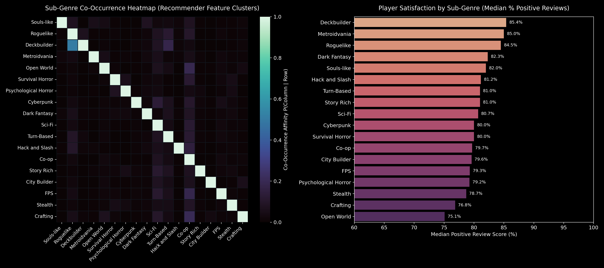
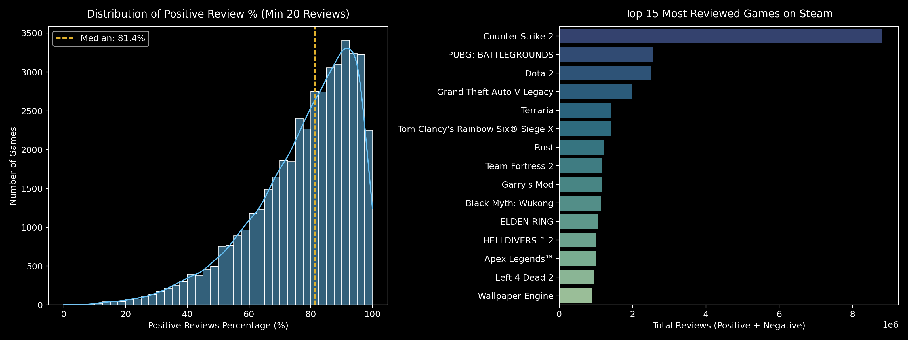
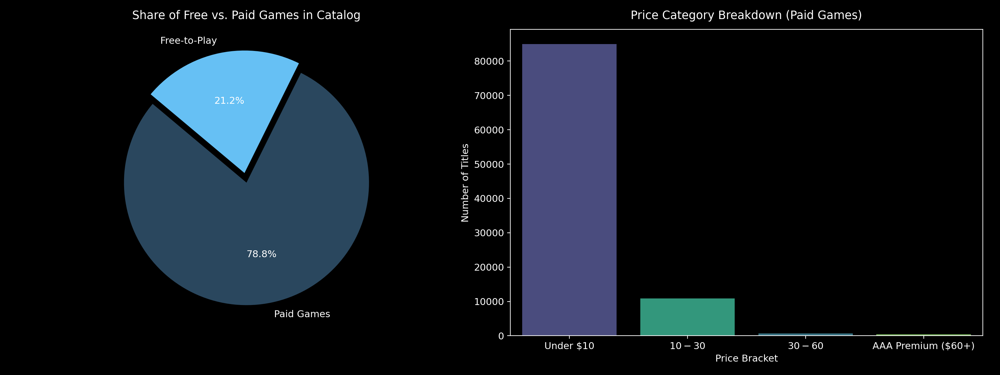
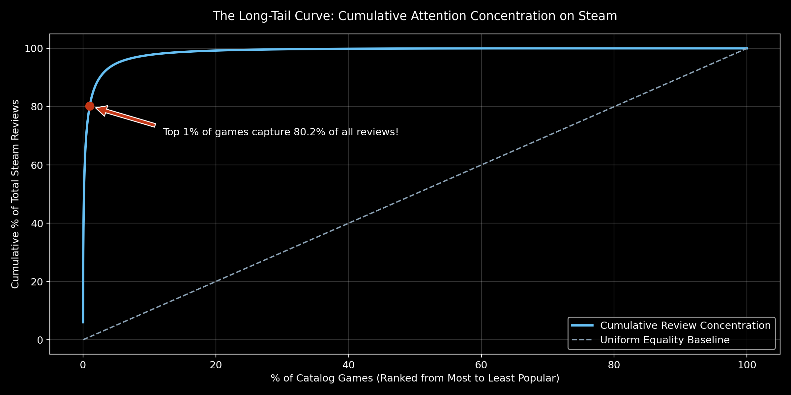
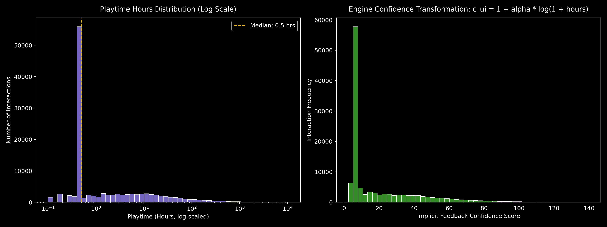

# 🎮 Steam Game Discovery & Recommender Engine (124,000+ Titles)

<div align="center">


</div>

We build a hybrid recommendation engine that blends semantic similarity, community credibility, and novelty-aware re-ranking to help players discover games that match both their taste and their curiosity. By combining TF-IDF semantic retrieval over Steam metadata with review-aware Bayesian quality checks, the system surfaces deep-cut gems without abandoning mainstream favorites that already have strong player consensus.

At the center of the project is a cyber-inspired Streamlit interface that converts raw Steam metadata into a polished discovery experience: real box art, affinity meters, explainability panels, and a live novelty dial that steers the engine between blockbuster safety and hidden-gem exploration.

---

## 🌌 Why this project matters

Steam is one of the most crowded digital game catalogs ever created, with more than 124,000 modern titles spanning genres, subgenres, release eras, and niche communities. Most discovery tools flatten this diversity into generic tags like "Action," "Adventure," or "RPG," which obscures the real patterns players care about: souls-like combat, deckbuilding, metroidvania exploration, roguelite progression, dark fantasy atmosphere, and co-op tactical play.

This project addresses that problem by combining:

- Semantic content understanding from titles, genres, tags, and descriptions
- Review and popularity calibration to avoid empty or low-signal recommendations
- Novelty-aware ranking to explore the long tail without drifting into low-quality noise
- Human-readable explanations showing why a recommendation was surfaced

> [!NOTE]
> The engine is designed for discovery, not just ranking. It explicitly balances community trust, content affinity, and fresh discovery opportunities so users can move beyond the most obvious Steam recommendations.

---

## 🖼️ UI and visual showcase

The app uses a cyber-glow, glassmorphism aesthetic with a four-layer design stack: dark UI chrome, glowing cyan/purple accents, Steam media assets, and explainability cards that help users understand each match.

### Interface overview



The Streamlit dashboard in `app.py` presents:

- Search and profile construction from favorite Steam titles
- Real Steam box art and metadata in each result card
- Affinity bars showing how strongly a game matches the selected profile
- "Why This Was Recommended" explanations grounded in shared tag overlap
- A novelty slider for moving between blockbuster safety and long-tail discovery

### EDA and signal visualizations

<div align="center">

| Visual | Description |
|---|---|
|  | Community review sentiment and distribution across the catalog. |
|  | Price segmentation and premium vs. free-to-play distribution. |
|  | Genre/subgenre co-occurrence structure and semantic clustering. |
|  | Long-tail discovery dynamics and popularity concentration. |
|  | Playtime-driven confidence shaping for implicit user interactions. |

</div>

> [!TIP]
> The app’s visual language is intentionally designed to feel premium and technical: subtle glow, translucent cards, polished spacing, and high-signal recommendation displays inspired by data-heavy AI tooling.

---

## 🧠 Core engineering and algorithmic architecture

### 1) TF-IDF semantic retrieval with production-grade noise suppression

The content layer is built by turning each game into a text "soup" from tags, genres, and short descriptions, then vectorizing it with `TfidfVectorizer`.

Key implementation details from `src/data_loader.py`:

- `max_df=0.25` to suppress ubiquitous terms that appear across too many games
- `sublinear_tf=True` to reduce the dominance of repeated tokens
- noise words filtered from both English stop words and a domain-specific list such as `action`, `adventure`, `rpg`, `indie`, `casual`, `singleplayer`, and `multiplayer`

This means we do not let generic categories dominate the vector space. Without this, titles like `Action, Adventure, RPG` across thousands of games blur together and cause recommendation collisions.

The actual retrieval step is:

$$
\text{sim}(u, g) = \frac{\mathbf{u} \cdot \mathbf{g}}{\|\mathbf{u}\|\|\mathbf{g}\|}
$$

where `u` is the normalized user profile vector and `g` is the normalized item vector. Similarity is computed using the cosine dot-product over L2-normalized TF-IDF vectors.

### 2) Bayesian review credibility regularization

To avoid overweighting low-volume, noisy titles, the recommender applies a Bayesian credibility prior to review quality.

The model intentionally uses a regularized trust signal before ranking:

$$
\text{Credibility}(v) = \frac{\log_{10}(1 + v)}{\log_{10}(1 + v) + 1.2}
$$

where $v$ is the number of reviews. This keeps games with a large, stable player base anchored in the ranking while preventing ultra-small review sets from dominating due to a few enthusiastic votes.

This is especially important when comparing:

- a niche indie title with 40 positive ratings and 97% approval
- a mainstream blockbuster with 120,000 reviews and 95% approval

The Bayesian term makes sure that community consensus and volume win over tiny sample-size outliers.

### 3) Novelty / serendipity dial

The user-facing novelty slider regulates the balance between mainstream safety and long-tail discovery. The ranking engine applies a popularity penalty that softens blockbuster dominance as novelty increases:

$$
\text{NoveltyPenalty} = 1 - \lambda \cdot \sqrt{\text{popularity}}
$$

where $\lambda \in [0,1]$ is the novelty dial and `popularity` is a normalized review-volume signal. This allows an experience to move smoothly from:

- $\lambda = 0.0$: mainstream, trusted blockbusters
- $\lambda \to 1.0$: hidden indie gems and cult-classic discoveries

The actual implementation in `src/recommender.py` applies this penalty after the similarity score and quality multiplier, which yields recommendation lists that are simultaneously high-signal and exploratory.

### 4) Why hard review cutoffs fail: the filter starvation problem

A common mistake in production recommender systems is applying a very hard positive-review cutoff such as 95% or 98% across the whole catalog. This creates a failure mode we call `filter starvation`:

- classic franchises and beloved niche titles often sit just below an arbitrary threshold because of older review-era noise or narrower audience composition
- a rigid cutoff removes many valid culturally important titles before the recommender can model their semantic fit
- users get a narrow, repetitive list dominated by newer mainstream hits and the system loses discovery diversity

Instead, the engine uses a soft Bayesian credibility regularizer plus a configurable minimum review threshold. That preserves the good signal from review communities without collapsing the long tail into a brittle filter bucket.

### 5) Explainability layer

Each recommended result returns not only a score but also the strongest source game behind its match and the overlapping tags that are driving the recommendation.

The system computes:

- strongest input match by semantic similarity to the selected games
- exact tag overlap and meaningful theme intersection
- shared traits such as `Souls-like`, `Dark Fantasy`, `Open World`, or `Deckbuilder`

This transforms the recommender from a black box into a trusted playlist assistant.

---

## 🗂️ Repository structure and workflow

```text
steam-game-recommender-engine/
├── app.py                          # Streamlit web app and cyber-glow UI
├── preprocess.py                  # End-to-end data cleaning and vector preparation
├── run_eda.py                     # Exploratory analysis and chart generation
├── requirements.txt               # Python dependencies
├── .gitignore                    # Ignored local data and generated outputs
├── README.md                     # Project overview and usage guide
├── data/
│   ├── fronkon_games.parquet     # Raw modern Steam catalog (124k+ titles)
│   ├── steam-200k.csv            # Implicit user interaction log
│   ├── preprocessed_catalog.parquet
│   └── preprocessed_interactions.parquet
├── notebooks/
│   └── eda_steam_games.ipynb    # Interactive notebook for EDA and feature exploration
├── reports/
│   └── figures/
│       ├── 01_sentiment_and_reviews.png
│       ├── 02_pricing_landscape.png
│       ├── 03_genre_and_subgenre_intelligence.png
│       ├── 04_long_tail_popularity_curve.png
│       └── 05_playtime_and_confidence.png
├── src/
│   ├── data_loader.py            # Catalog ingestion, TF-IDF indexing, metadata load
│   ├── recommender.py            # Matching, scoring, novelty weighting, explainability
│   └── evaluate.py               # Benchmarking logic for retrieval quality and coverage
└── download_latest.py             # Optional pipeline to fetch the latest catalog snapshot
```

### EDA notebook

The notebook in `notebooks/eda_steam_games.ipynb` is the analytical heart of the repository. It covers:

- review-volume distributions and sentiment shape
- price and platform segmentation
- genre/subgenre occurrence patterns
- long-tail discovery curves
- implicit playtime confidence transformations
- visual checks used to validate recommendation quality before deployment

---

## ⚡ Quickstart and reproduction guide

### 1) Clone the repository

```bash
git clone https://github.com/itsjustRohitch/Steam-Game-Recommender-Engine-Project.git
cd Steam-Game-Recommender-Engine-Project
```

### 2) Install dependencies

```bash
python -m venv .venv
source .venv/bin/activate  # Windows: .venv\Scripts\activate
pip install -r requirements.txt
```

### 3) Run preprocessing

```bash
python preprocess.py
```

This builds the cleaned Parquet artifacts in `data/` used by the recommender engine.

### 4) Launch the app

```bash
streamlit run app.py
```

Then open the local URL printed by Streamlit, typically:

```text
http://localhost:8501
```

### 5) Generate EDA visuals

```bash
python run_eda.py
```

This produces the high-quality chart exports in `reports/figures/`.

> [!NOTE]
> Some dataset files are large and may not be committed directly. If the raw Steam catalog is missing, download or prepare the required files first as expected by `preprocess.py` and `src/data_loader.py`.

---

## ☁️ Streamlit Community Cloud deployment

Deploying to Streamlit Cloud is simple and production-friendly:

1. Push this repository to GitHub.
2. Open [Streamlit Community Cloud](https://streamlit.io/cloud).
3. Click `New app`.
4. Select your repository and branch.
5. Set the main file to `app.py`.
6. Click `Deploy`.

The app will then be available at a URL like:

```text
https://<your-repo-name>.streamlit.app
```

> [!TIP]
> If you want a clean deployment, pin your dependency versions in `requirements.txt` and keep the dataset pipeline reproducible with a fixed preprocessing flow.

---

## 🧾 JSON export schema

The app includes a one-click export button that downloads a machine-readable payload for the recommendation session.

Example output schema:

```json
{
  "generated_at": "2026-10-25T16:30:00",
  "recommender_configuration": {
    "novelty_dial": 0.2,
    "min_review_pct_filter": 70.0,
    "top_k": 10,
    "retrieval_latency_ms": 62.4
  },
  "input_selected_games": [
    {
      "game_title": "God of War",
      "appID": 1593500,
      "price": 19.99,
      "review_score_pct": 96.2,
      "total_reviews": 135000,
      "genres": "Action, Adventure, RPG",
      "tags": "Story Rich, Action, Mythological, Hack and Slash"
    }
  ],
  "recommended_games": [
    {
      "rank": 1,
      "game_title": "Hades",
      "appID": 1145360,
      "affinity_score_pct": 89.7,
      "similarity_correlation_pct": 81.6,
      "attributed_source_game": "God of War",
      "shared_tags": ["Action", "Story Rich", "Mythological"],
      "price": 24.99,
      "review_score_pct": 95.4,
      "total_reviews": 110000,
      "release_date": "2020-09-17",
      "popularity_tier": "Popular Favorite",
      "genres": "Action, Roguelite, Indie",
      "tags": "Roguelike, Action, Fast-Paced, Story Rich"
    }
  ]
}
```

This exported payload is ideal for:

- portfolio demos
- downstream recommendation analytics
- offline re-ranking experiments
- API-style integration with frontends or dashboards

---

## 📚 Dataset credits and acknowledgements

This project relies on a small set of high-value Steam data sources and community resources. We acknowledge them here explicitly.

- FronkonGames (Martin Bustos) — Modern Steam Games Dataset 124,000+ titles
  - Hugging Face: https://huggingface.co/datasets/FronkonGames/steam-games-dataset
  - Kaggle: https://www.kaggle.com/datasets/fronkongames/steam-games-dataset
- Valve Corporation — Steam Web API and storefront metadata, box art, pricing, and catalog structure
- SteamSpy — concurrent player and engagement estimates used in popularity and vitality analysis
- Steam 200k Interaction Dataset — implicit user playtime data for confidence and interaction modeling

These sources were used to build a realistic discovery engine that mirrors the way Steam users navigate the catalog: by taste, community consensus, and niche sub-genre affinity.

---

## 🚀 Project summary

This repository brings together modern search and recommender system design in a way that is both technically rigorous and visually compelling. It is ideal for:

- portfolio presentation
- ML recommendation demos
- exploratory data analysis on a large real-world catalog
- discussions of semantic retrieval, novelty balancing, and explainable ranking systems

The final result is a recommendation engine that feels more like a modern discovery assistant than a simple collaborative filter: it understands the shape of a player's taste and helps them step outside the obvious choices in a trustworthy way.

---

## 📌 License

Developed as an academic project for educational and research purposes.
